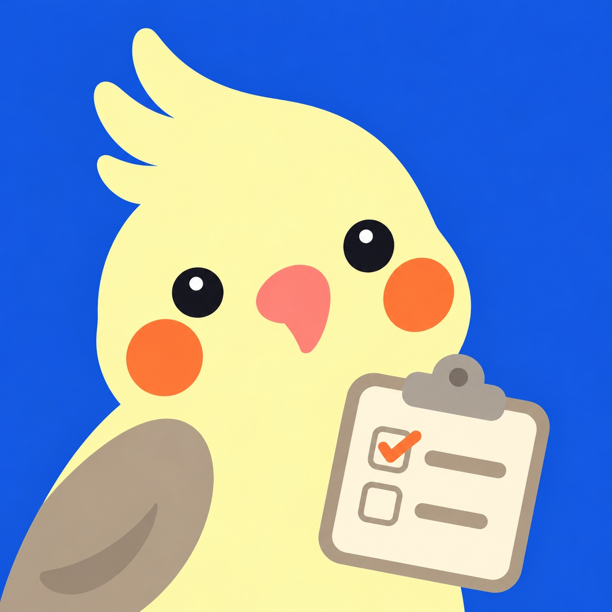

<div align="center">
  

  <h1>슬슬 · SeulSeul</h1>
  <p><strong>Slack 공지를 학생마다 해야 할 일로 정리하는 체크리스트 봇</strong></p>
  <p>공지 속 제출 링크와 마감일을 모아 개인 DM에 보여 주고, 완료 상태를 관리합니다.</p>
  <p>Python 3.11 · Slack Socket Mode · PostgreSQL · NVIDIA Build API / Ollama</p>
</div>

## 한눈에 보기

```text
Slack 공지 → 제출 링크·마감일 분석 → 학생별 체크리스트 → 개인 DM에서 완료 관리
```

| 학생에게 | 운영자에게 |
| --- | --- |
| `/seulseul 시작`으로 가입하고 한 개의 DM에서 미완료·완료 목록을 봅니다. | `./admin.sh` 관리 콘솔에서 공지 상태, 실패, 백업과 서비스를 확인합니다. |
| `✓`로 완료, `↶`로 취소합니다. 새 공지나 원문 변경은 같은 DM에 반영됩니다. | AI 분석 실패 공지를 재처리하거나, 봇이 없는 채널의 공지를 직접 등록·수정·삭제합니다. |

마감 24시간 이내의 미완료 항목은 별도 DM으로 알립니다. 실제 폼 제출 여부는 확인하지 않으므로 학생이 제출 후 완료 버튼을 눌러야 합니다.

> [!NOTE]
> 현재 학생 소속은 Slack 프로필의 **성명** `4기_광주_<1~4>반_<이름>`으로 판별합니다. 표시 이름은 자유롭게 사용할 수 있습니다.

## 원하는 곳으로 이동

- **처음 사용한다면:** [학생 사용법](#학생-사용법) → [로컬 개발 시작](#로컬-개발-시작)
- **운영 중이라면:** [운영 서버](#운영-서버) → [운영자 명령 빠른 안내](docs/OPERATIONS.md)
- **문제를 확인한다면:** [공지 재처리와 로그](#공지-재처리와-로그) → [상세 운영·진단 절차](docs/RUNBOOK.md)
- **구현을 살핀다면:** [제품 정책](docs/PRODUCT.md) · [아키텍처](docs/ARCHITECTURE.md) · [결정 기록](docs/DECISIONS.md)

## 학생 사용법

1. Slack 프로필의 **성명**을 `4기_광주_2반_홍길동`처럼 설정합니다. `2`는 본인 반 번호로 바꿉니다.
2. Slack에서 `/seulseul 시작`을 입력합니다. 봇과의 개인 DM에 체크리스트가 도착합니다.
3. 제목을 눌러 제출 링크로 이동한 뒤, 실제 제출을 마치면 `✓`를 누릅니다. `완료 보기`에서 `↶`로 취소할 수 있습니다.
4. 사용을 끝내려면 `/seulseul 해지`를 입력합니다. 학생 정보와 개인 체크리스트가 삭제됩니다.

체크리스트는 처음 연결할 때 한 번 보내고 이후 **같은 메시지를 갱신**합니다. 공지 수정·삭제, 마감 경과, 정상적인 반 변경도 반영하며 기존 완료 기록을 보존합니다. `/seulseul 시작`을 다시 실행하면 기존 봇 DM을 정리하고 새 체크리스트를 보냅니다. [화면·동기화 세부 규칙](docs/RUNBOOK.md#최초-연결-후-계속-갱신하는-개인-체크리스트)

## 로컬 개발 시작

**필요한 것:** Python 3.11, Docker Compose, Slack 앱 토큰, PostgreSQL 접속 정보. 공지를 분석해 체크리스트에 배정하려면 NVIDIA Build API 또는 Ollama 설정도 필요합니다.

1. 가상환경과 설정 파일을 준비합니다.

   ```bash
   python3.11 -m venv .venv
   source .venv/bin/activate
   python -m pip install -e '.[dev]'
   cp .env.example .env
   ```

2. `.env`에 최소한 아래 값을 채웁니다. 채널 ID는 실제 Slack 워크스페이스 값으로 바꿉니다. [전체 설정 예시](.env.example)

   | 설정 | 용도 |
   | --- | --- |
   | `SLACK_BOT_TOKEN`, `SLACK_APP_TOKEN` | Slack 봇·Socket Mode 연결 |
   | `SLACK_NOTICE_CHANNELS` | 봇이 이벤트로 읽을 공지 채널 ID 목록 |
   | `SLACK_NOTICE_TARGETS` | 각 채널의 대상: `all` 또는 `1`~`4` |
   | `POSTGRES_DB`, `POSTGRES_USER`, `POSTGRES_PASSWORD`, `DATABASE_URL` | 로컬 PostgreSQL 초기화와 접속 |
   | `AI_PROVIDER`와 해당 제공자 설정 | `nvidia` 또는 `ollama` 분석기 |

   예를 들어 전체 공지와 2반 공지를 분리하려면 다음과 같이 지정합니다.

   ```dotenv
   SLACK_NOTICE_CHANNELS=C0000000001,C0000000002
   SLACK_NOTICE_TARGETS=C0000000001=all,C0000000002=2
   ```

3. PostgreSQL을 시작하고 마이그레이션을 적용한 뒤 봇을 실행합니다.

   ```bash
   docker compose up -d postgres
   .venv/bin/alembic upgrade head
   .venv/bin/python -m seulseul.main
   ```

로컬에서는 PostgreSQL만 Docker에서 실행합니다. 앱은 `.venv`에서 실행하며, 개발 DB를 멈출 때는 `docker compose down`으로 볼륨을 보존합니다. Slack 앱 권한·이벤트·명령은 [slack-manifest.yaml](slack-manifest.yaml)에 맞춥니다. OAuth scope를 새로 적용했다면 앱을 재설치하고 새 토큰을 `.env`에 반영합니다. [채널 설정과 첫 연결 상세 절차](docs/RUNBOOK.md#최초-연결-후-계속-갱신하는-개인-체크리스트)

## 운영 서버

운영 명령은 서버의 `seulseul` 계정으로 `~/app`에서 실행합니다. 운영 Compose는 `compose.prod.yaml`이며 Rootless Docker를 사용합니다. **로컬 개발 봇에는 아래 스크립트를 사용하지 않습니다.** [운영 환경 준비](docs/DB-TODO.md)

```bash
./run.sh setup       # .env가 없을 때 템플릿 생성
nano .env            # 운영 값 입력
./view.sh config     # 설정 검증 (값은 출력하지 않음)
./run.sh             # 빌드 → DB 준비 → 마이그레이션 → 서비스 재시작
./view.sh            # 서비스 상태
./admin.sh           # 전체 화면 관리 콘솔
```

| 자주 쓰는 명령 | 용도 |
| --- | --- |
| `./admin.sh notice` | 공지 등록·수정·삭제. 봇이 없는 채널의 원문도 등록 |
| `./admin.sh retry` / `./admin.sh retry N` | AI 실패 목록 / 선택한 공지 재분석 |
| `./admin.sh retry pending` | 아직 반영되지 않은 Slack 원본 조회 |
| `./admin.sh backup` | 운영 DB 백업. 기존 백업은 보존 |
| `./admin.sh backup status` | 자동 백업 예약과 최근 성공 기록 확인 |
| `./view.sh dashboard` | 공지 처리 현황과 조치 목록 |
| `./view.sh logs bot --follow` | 봇 로그 실시간 보기 |
| `./view.sh logs search` | 모든 서비스·수동 공지·재배포 전 보관 로그 검색 |
| `./stop.sh` | 서비스 중지. DB 볼륨은 보존 |

관리 콘솔에서 같은 작업을 메뉴로 실행할 수 있습니다. 자동 백업은 `./admin.sh backup schedule`로 **매일 03:00 Asia/Seoul**에 예약합니다. 코드 업데이트는 운영 데이터 백업을 확인한 뒤 `git pull --ff-only origin main` → `./run.sh` 순서로 반영합니다. 마감 알림 적용 전에는 `e05243bd795f` 마이그레이션이 필요합니다. [배포·백업·OAuth 상세 절차](docs/RUNBOOK.md#운영-서버-간편-명령) · [운영자 명령 전체 표](docs/OPERATIONS.md)

> [!IMPORTANT]
> 운영 봇은 한 프로세스만 실행합니다. 같은 Slack 앱의 로컬 봇을 동시에 연결하면 명령과 버튼 이벤트가 서로 다른 프로세스로 갈 수 있습니다. 운영 DB 포트는 루프백 `127.0.0.1:15432`에만 연결하며 외부 조회는 [SSH 터널 절차](docs/DB-ACCESS.md)를 따릅니다.

## 공지 재처리와 로그

일시적인 AI·연결 장애는 **5분 → 15분 → 1시간** 간격으로 최대 3회 자동 재처리합니다. 계속 실패하면 `./admin.sh retry`에서 번호를 확인하고 `./admin.sh retry N`으로 다시 분석합니다. AI 대신 제목·요약·마감일을 직접 입력하거나 봇이 없는 채널의 공지를 등록할 때는 `./admin.sh notice`를 사용합니다. [수동 공지 절차](docs/RUNBOOK.md#운영자-수동-공지-처리)

`./view.sh logs bot`은 최근 로그를 읽기 쉬운 형식으로 보여 줍니다. 관리 콘솔 4번 또는 `./view.sh logs search`로 봇·OAuth·ngrok·DB·수동 공지 기록 전체에서 검색합니다. 예: `./view.sh logs search --from "2026-10-26 09:00" --to "2026-10-26 18:00" --user "홍길동" --action "완료" --text "공지"`. 시각은 한국 시간이며 기본 결과는 `시각 | 상태 | 서비스 | 사용자 | 작업 | 결과`로 표시합니다. 같은 체크리스트 버튼 시도의 접수·검증·결과는 한 줄로 묶습니다. 사용자 정보가 기록되지 않은 행은 사용자 검색에 나오지 않습니다. 기본 최신 100건을 보여 주고 `--all`은 모든 검색 결과, `--raw`는 원본, `--service bot`은 서비스별 검색입니다. 재배포 전 컨테이너별 로그는 저장소 밖 `~/logs/archive/`에 보관됩니다. 이 기능을 적용하기 전에 이미 삭제된 컨테이너의 로그는 복구할 수 없습니다. 수동 공지 처리 로그는 `./view.sh logs manual`에서도 봅니다. 체크리스트 버튼 오류는 `--raw` 로그의 `trace_id`로 수신·검증·결과를 대조합니다. [체크리스트 버튼 오류 로그 확인](docs/RUNBOOK.md#체크리스트-버튼-오류-로그-확인)

## 검증과 문서

```bash
./scripts/check.sh
```

문법 검사, 테스트, Ruff 검사와 포맷 검사를 실행합니다. 스크립트가 프로젝트 `.venv`를 Python 3.11로 준비하고 개발 의존성을 맞춥니다. Python 3.11 자체는 미리 설치되어 있어야 합니다.

| 문서 | 내용 |
| --- | --- |
| [운영자 명령 빠른 안내](docs/OPERATIONS.md) | 관리 콘솔과 자주 쓰는 명령 |
| [상세 운영·진단 절차](docs/RUNBOOK.md) | 백업, OAuth, 공지 처리, 로그와 장애 대응 |
| [제품 개요](docs/PRODUCT.md) | 사용자 흐름, 용어, 처리 범위 |
| [아키텍처](docs/ARCHITECTURE.md) | 패키지 책임과 요청 흐름 |
| [DB 접근](docs/DB-ACCESS.md) · [운영 환경](docs/DB-TODO.md) | SSH 터널과 서버 준비 |
| [작업 현황](docs/PLANS.md) · [결정 기록](docs/DECISIONS.md) | 미검증 항목과 정책 근거 |
